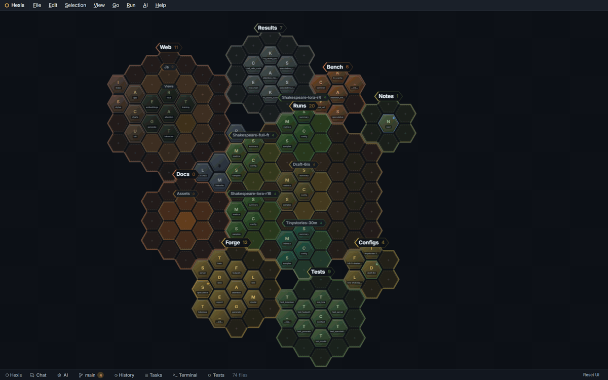
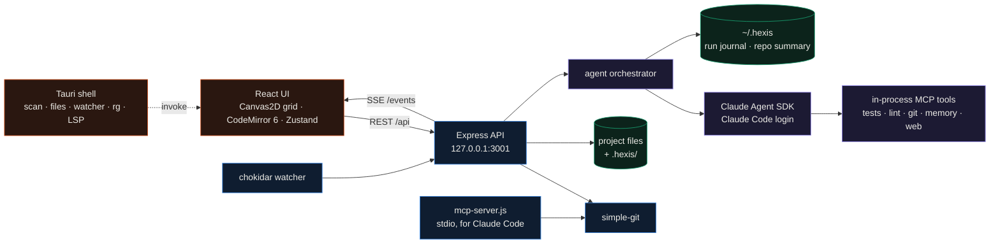
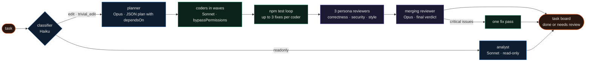
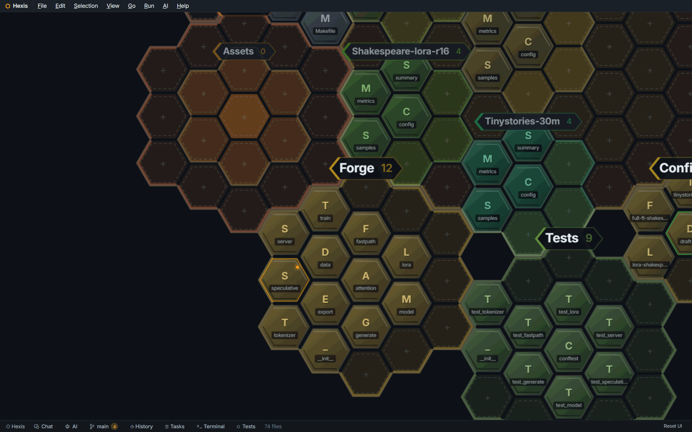
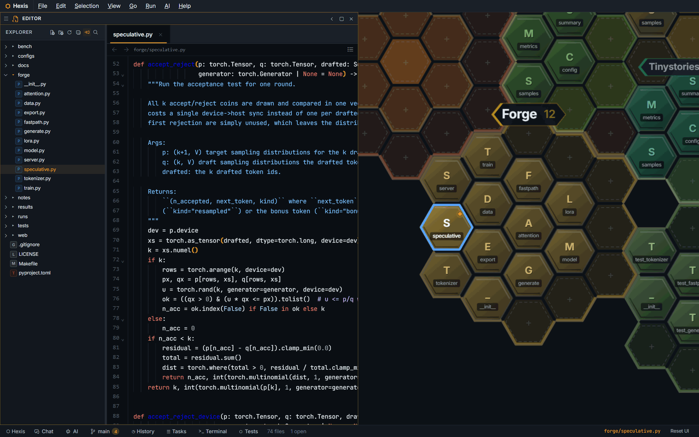
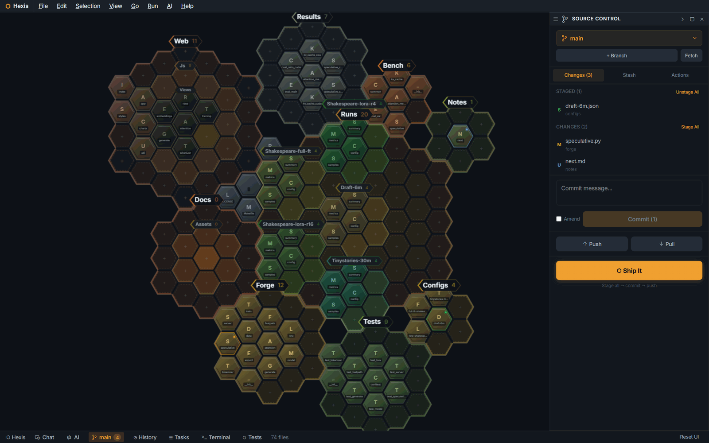
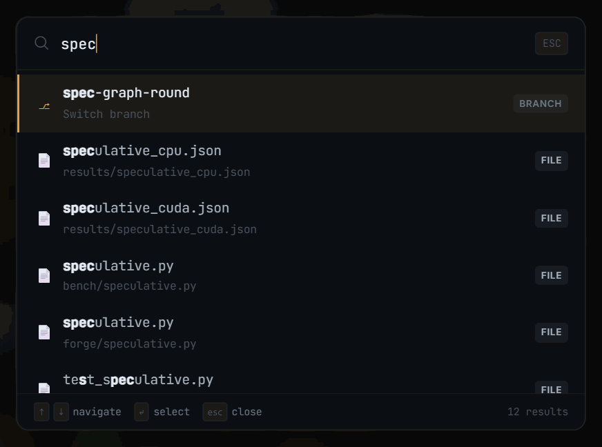
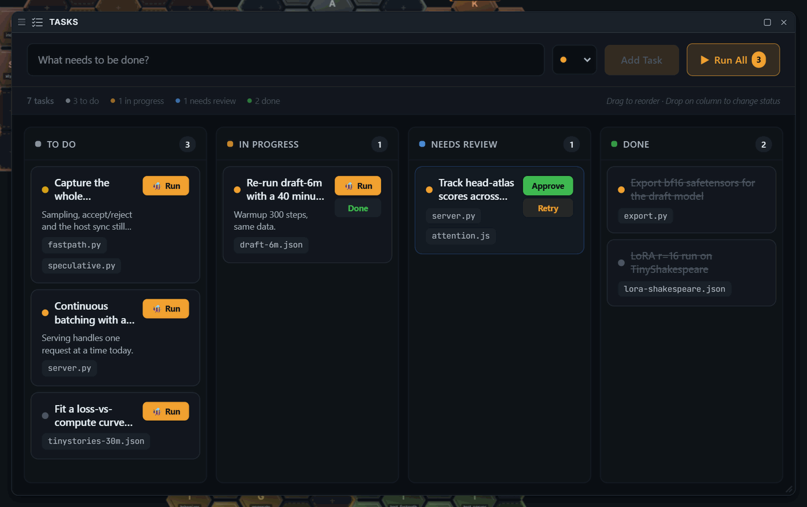
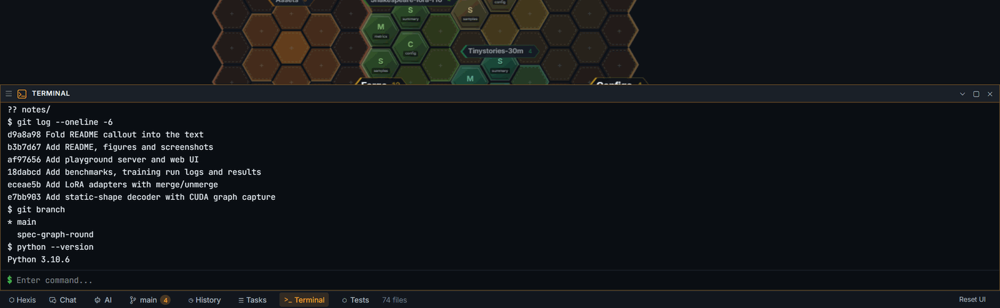

<div align="center">

# Hexis

**An IDE that draws your repository as a honeycomb: files are hex cells, folders are territories, and Claude agents work on it as bees.**


</div>

I built Hexis because a file tree tells you where things are but not how big anything is or what is changing.
Hexis scans a project, packs every folder into a hexagonal territory and every file into one cell, and keeps
that map next to an editor, a git panel and a terminal. Claude agents run against the same project through the
Claude Agent SDK, and the grid shows which files each agent is reading and editing while it works.

## Highlights

- The layout engine packs nested folders as nested hexagons. A folder of ring r holds 3r² + 3r + 1 cells, always keeps one empty cell as a drop target, and the result is deterministic for a given tree. 50 Vitest tests cover the hex math and the packer.
- The grid is one Canvas2D layer with five semantic zoom levels between zoom 0.05 and 5, from coloured dots for the whole project down to labelled cells with git badges. Double-click a folder to fly into it, click a file to open it.
- Dragging a file or a folder onto another territory moves it on disk after a confirm dialog. Tracked files move with `git mv`, relative markdown links that pointed at a moved file are rewritten and staged, and file operations have their own undo and redo.
- Git goes through simple-git: stage and unstage, commit and amend, create and switch branches, stash and pop, fetch, pull and push, plus a "Ship It" button that stages everything, commits and pushes.
- An agent run goes through an intent classifier, then either a read-only analyst or a planner, coders scheduled in dependency waves, a test loop, three persona reviewers and a merging reviewer. The task board runs up to three at once, and the rules in `.hexis/memories/learned.md` (read when the server starts) go into every agent's system prompt.
- A standalone MCP server (`mcp-server.js`, stdio) gives Claude Code nine read-only tools over the same file graph and git state.

<p align="center"></p>

---

## How it works



The UI talks to one Express process over REST and listens on a single SSE stream for file changes, agent events
and chat tokens. On load it asks for `/api/graph`. The server walks the project (skipping dot-folders,
`node_modules`, build output and binary files), reads frontmatter and markdown links, and runs `git log` on each
file for its age and change count. The browser turns that into files and folders and runs the hex layout itself,
so the server never deals in cells. The watcher batches changes for 500 ms, pushes them over SSE, and the client
fetches the graph again.

Under Tauri the same React app gets the file list, file I/O, workspace search, a file watcher and language servers
from Rust commands instead, and keeps scan results in SQLite. Git, the terminal, tests and agents still go through
the Express API, which the Tauri dev window reaches through the Vite proxy and a packaged build can't reach yet (see
[Limitations](#limitations)).



Every step is a `query()` call to the Claude Agent SDK with a role profile from `server/agent-profiles.js` (model,
effort, turn limit) and a tool list for that role. The classifier, analyst, planner and persona reviewers run in the
SDK's `plan` permission mode. Coders, chat turns and the merging reviewer run in `bypassPermissions`. The planner
returns subtasks with `dependsOn` lists, and the scheduler packs them into waves: a subtask runs once its
dependencies are done and no other subtask in the same wave touches the same file. A coder that touches source files
triggers `npm test -- --run` and gets up to three attempts to fix failures. Runs classified as `trivial_edit` skip the
review.

A PreToolUse hook refuses Write and Edit calls on lockfiles, `.env` files, `tauri.conf.json`, `node_modules` and
`.git`. Every Read, Write and Edit call is streamed to the UI as it happens, and that agent's bee flies to the cell.
Transient errors retry with backoff, and an agent that makes the same tool call five times in a row is stopped.
Chat mode skips the pipeline: each message is one Sonnet (or Opus) turn with the coder's tools that resumes the
previous SDK session. The research pipeline (`/research` in chat) plans with Opus, fans out to two to five Sonnet
workers, ranks the options against a rubric, runs an adversarial critic and saves a report under
`.hexis/memories/research/`. [docs/architecture.md](docs/architecture.md) has the details.

## The interface

### The grid



Each top-level folder gets its own colour, and subfolders shift its hue. The label plate on a territory shows how
many files it holds. A cell shows the file's initial and name, and git status is a corner dot plus a thin border:
amber for modified, green for staged, blue for untracked. Hovering a cell lights up its folder and dims everything
else. Here `forge/` fills the screen, and `speculative.py` has the amber dot from an uncommitted edit. Right-click
gives new file and folder, rename, delete (to the OS trash), cut, copy, paste and "move out to" for cells and whole
territories. The layout is saved to `.hexis/layout.json`, so territories keep their places between sessions, and
Ctrl+Shift+L repacks from scratch.

### Editor



The editor is CodeMirror 6 with modes for 22 languages and formats, tabs, an outline, bookmarks, a jump list and
local history snapshots on every save. It docks on the left with a file tree, and the grid stays live on the right
with the cell you clicked still selected. Ctrl+K inside the editor sends the selection to Claude for an inline
rewrite. Go-to-definition, rename and the outline work from symbols the editor extracts itself; the Tauri shell also
has a bridge to `rust-analyzer`, `typescript-language-server`, `pyright-langserver` and `gopls`.

### Git



The Source Control panel (Ctrl+G) lists staged, modified and untracked files, with a commit box, amend, push, pull
and "Ship It", a branch switcher, and tabs for stashes and fetch. The same three changes show up on the grid as
coloured dots on `speculative`, `draft-6m` and `next`. Ctrl+T opens a commit timeline strip.

### Command palette



Ctrl+K outside the editor opens a fuzzy palette over files, commands and branches. Picking a branch checks it out.
Starting the query with `#` searches symbols from files you have opened.

### Task board



Ctrl+B opens a kanban board with To Do, In Progress, Needs Review and Done. Tasks carry a priority and the files they
touch, and Run sends one to the agent pipeline. A finished run lands in Done if the review approved it and in Needs
Review otherwise. The tasks in the screenshot were entered by hand for the demo project; none of them was run.

### Terminal



Ctrl+\` opens a command runner in the project root. It runs one command at a time through the system shell; see the
limitations below.

## Keyboard shortcuts

Taken from the key handlers in `src/App.jsx`, `src/components/editor/EditorPanel.jsx` and
`src/components/editor/extensions.js`. On macOS, Cmd works in place of Ctrl.

| Keys | Action |
|---|---|
| Ctrl+K | Command palette (outside the editor), inline AI edit of the selection (inside the editor) |
| Ctrl+E · Ctrl+Shift+E | Toggle the editor · show the editor and toggle its file tree |
| Ctrl+G | Source Control panel |
| Ctrl+T | Commit timeline |
| Ctrl+B | Task board |
| Ctrl+\` | Terminal |
| Ctrl+I | AI agents panel |
| Ctrl+J · Ctrl+Shift+C | Chat panel |
| Ctrl+/ | Focus the chat input |
| Ctrl+Shift+F | Workspace search (needs ripgrep) |
| Ctrl+S | Save |
| Ctrl+N · Ctrl+Shift+N | New file · new folder, in the selected cell's folder |
| Ctrl+O | Open folder (Tauri only) |
| Ctrl+Shift+L | Re-pack the hex layout from scratch |
| Ctrl+Z · Ctrl+Y or Ctrl+Shift+Z | Undo · redo file operations (outside the editor) |
| Ctrl+X · Ctrl+C · Ctrl+V | Cut · copy · paste the selected cell (outside the editor) |
| Escape | Clear the selection; outside the editor and dialogs it also jumps to the chat input |
| Ctrl+G (editor) | Go to line |
| Ctrl+Shift+O | Outline |
| Alt+Left · Alt+Right | Jump back · forward |
| F12, Ctrl+F12 or Ctrl+click | Go to definition |
| Alt+F12 | Peek definition |
| F2 | Rename the symbol in this file |
| Ctrl+F2 · Ctrl+Shift+F2 · Ctrl+Alt+F2 | Toggle · next · previous bookmark |
| Alt+Up · Alt+Down | Expand · shrink selection |

On the grid: wheel to zoom, drag empty background to pan, click a file to open it, double-click a file or folder to
zoom to it and double-click it again to zoom back out, drag a cell or a folder label to move it.

## Quickstart

Requirements: Node.js 20 or newer (I used 22.13.1) and git. Optional: ripgrep (`rg`) for workspace search, a Claude
Code login for anything AI, `uv` if you want planner, coder and reviewer agents to use Serena, and the Rust toolchain
plus Tauri's platform prerequisites for the desktop app.

```bash
npm install

# API on 127.0.0.1:3001 and the UI on http://localhost:5173
HEXIS_TARGET=/path/to/your/project npm run dev
```

On Windows PowerShell: `$env:HEXIS_TARGET = "C:\path\to\project"; npm run dev`. Without `HEXIS_TARGET` the server
opens the Hexis checkout itself.

The API can also run on its own. `cli.js` (the `hexis` bin) takes a path and an optional `--port`; `npm start` runs it
with no path, which means the Hexis folder itself. The UI then comes from the Vite dev server, whose proxy expects the
API on port 3001:

```bash
node cli.js /path/to/your/project     # API only
npm run dev:client                    # UI, in a second terminal
```

Desktop window and release build. `tauri.conf.json` has no `beforeDevCommand`, so start the dev servers first:

```bash
npm run dev            # terminal 1
npm run tauri:dev      # terminal 2: Tauri window on http://localhost:5173
npm run tauri:build    # vite build, then the release bundle for this OS (read the limitations first)
```

Tests and the MCP server:

```bash
npx vitest run         # 50 tests: hex math and the layout packer

claude mcp add hexis -- node /path/to/hexis/mcp-server.js /path/to/your/project
```

## Configuration

| Variable | Default | What it does |
|---|---|---|
| `HEXIS_TARGET` | the Hexis checkout | Project to open. A path passed as the first argument to `server/index.js` or `cli.js` wins over it. |
| `HEXIS_PORT` | `3001` | API port. The Vite proxy in `vite.config.js` is fixed to 3001. |
| `HEXIS_HOST` | `127.0.0.1` | Address the API binds to. |
| `HEXIS_ALLOWED_ORIGINS` | `http://localhost:5173`, `http://127.0.0.1:5173` and the Tauri origins | Comma-separated Origin allow-list. |
| `HEXIS_DISABLE_SERENA` | unset | `1` stops agents from starting the Serena MCP server. |
| `HEXIS_BACKGROUND_AGENTS` | unset | `1` warms up the SDK and builds the repo summary at startup. Both are model calls made before you ask for anything. |
| `GITHUB_TOKEN` | unset | Optional, raises the GitHub search rate limit for research agents. |

Claude access goes through the Claude Code CLI that ships inside `@anthropic-ai/claude-agent-sdk` (0.2.98). Hexis
deletes `ANTHROPIC_API_KEY` from the environment it passes to the SDK for agents, chat, inline edits and the repo
summary, so those run on the Claude Code login of the user running the server: log in once with the `claude` CLI.
The `/mem consolidate` and `/compact` helpers pass the environment through unchanged. Per-role models are in
`server/agent-profiles.js`: Haiku for the classifier and task writer, Opus with adaptive thinking (falling back to
Sonnet) for the planner, merging reviewer and research lead, Sonnet for everything else. Chat can switch to Opus.

Hexis writes into the project it opens: `.hexis/layout.json` for territory positions and `.hexis/memories/` for the
conventions file, its usage stats and research reports. Run journals and the cached repo summary go to
`~/.hexis/`, and UI state (panels, chats, tasks, bookmarks, local history) stays in the browser's localStorage. To
keep the conventions in git and ignore the rest, add this to the project's `.gitignore`:

```gitignore
.hexis/*
!.hexis/memories/
.hexis/memories/*
!.hexis/memories/learned.md
```

## Security

Hexis has a lot of reach on the machine it runs on. The API can run shell commands (`/api/terminal/exec`), write and
delete files inside the project, and run git up to push and `reset --hard`. File endpoints refuse paths that resolve
outside the project, but there is no login, so any program running on the same machine can call it. What the server
does is keep other machines and other websites out. It binds to 127.0.0.1 unless `HEXIS_HOST` says otherwise, and it
checks every request before routing. The
Host header has to be `localhost`, `127.0.0.1` or `[::1]`, which stops DNS rebinding. A request that carries an Origin
has to match `HEXIS_ALLOWED_ORIGINS`, and anything the browser marks `Sec-Fetch-Site: cross-site` is refused. I sent
all three kinds of request with curl and each came back 403.

Agents that write code (coders, chat turns and the merging reviewer) run in the SDK's `bypassPermissions` mode, so
they never stop to ask before a tool call. The orchestrator can isolate a run in a git worktree under
`~/.hexis/worktrees`, but the runs the UI starts don't turn that on, so agents edit your working tree directly. The
protected-file hook only covers the Write and Edit tools, not Bash. Agents also load the project's `CLAUDE.md`,
`AGENTS.md` and `.claude/` settings. Only point Hexis at projects you trust, and commit before you start a run. Typing
a task into the task board starts a run as soon as one of the three slots is free.

Opening a project doesn't start an agent. With `HEXIS_BACKGROUND_AGENTS=1` the server sends a one-turn "ping" at
startup to warm up the SDK, and when there is no cached repo summary for the current HEAD it runs a Sonnet agent (Read,
Glob and Grep only, up to 25 turns) to write one into `~/.hexis/wiki-<hash>.json`. Without the flag, agents run without
that summary. Research agents send queries to DuckDuckGo and fetch pages through `r.jina.ai`, besides the GitHub,
Hacker News, arXiv and npm APIs. Planner, coder and reviewer agents start Serena with `uvx`, pinned to the commit behind
its v2.1.0 tag; `HEXIS_DISABLE_SERENA=1` turns that off.

## Repository map

```text
server/
  index.js               Express API: files, git, terminal, tests, memory, agents, SSE, localhost guard
  graph-builder.js       project walk into files, folders, markdown-link edges and git metrics
  watcher.js             chokidar watcher, 500 ms batches pushed over SSE
  git-analyzer.js        simple-git wrappers: status, log, branches, stash, blame, revert, reset
  link-updater.js        rewrites markdown links after a file move
  agent-orchestrator.js  classifier, planner, wave scheduler, coders, reviewers, chat, research
  agent-profiles.js      model, effort and turn limit per role
  agent-hooks.js         protected-file guard, edit tracking, git history for focus files
  hexis-mcp-tools.js     in-process MCP tools for agents: tests, lint, git, memory, web research
  research-tools.js      DuckDuckGo, Jina Reader, arXiv, GitHub, HN and npm fetchers
  repo-context.js        AGENTS.md / CLAUDE.md, cached repo summary, learned conventions
  state-store.js         run journal in ~/.hexis/state-<hash>.json
  worktree-manager.js    optional per-run git worktrees
  parsers/               directory scan, frontmatter, markdown links
src/
  App.jsx                layout, menus, keyboard shortcuts, SSE wiring
  components/HexGrid/    canvas renderer, viewport, cell and folder drawing, drag and drop, bees
  components/utils/      hexMath.js and hexLayout.js, with their tests
  components/editor/     CodeMirror panel, symbols, go-to-definition, inline AI edit
  components/            git, chat, AI, task board, terminal, search, timeline, memory, dock panels
  stores/                Zustand stores: editor, git, agents, chat, tasks, panels, history
src-tauri/               Rust shell: project scan into SQLite, file ops, watcher, ripgrep, LSP bridge
cli.js                   hexis [path] [--port N], starts the API server
mcp-server.js            stdio MCP server with nine graph and git tools
docs/                    architecture notes and screenshots
```

## Limitations

- I've only run Hexis on Windows 11. The GitHub workflow builds Tauri bundles for Windows, macOS and Ubuntu when a version tag is pushed, but I haven't run the app on macOS or Linux.
- I didn't run the agents for this README. The server ran with no Claude login, so the screenshots show the IDE side only, and the agent sections above describe the code.
- Opening a large project is slow. The graph builder runs `git log` once per file, one file after another, and the UI fetches the whole graph again after every batch of file changes. On the 74-file project in the screenshots that took 35 s on my machine while it was busy with other jobs.
- I compiled the Tauri shell on Windows and opened it both ways. With the dev servers running, the window loads `http://localhost:5173` and behaves like the browser version. A packaged build (compiled with Tauri's `custom-protocol` feature, as `tauri build` does) shows the grid and the editor from the Rust scan, but nothing starts the Node server, every `/api` call comes back as the app's own `index.html`, and the CSP blocks `127.0.0.1:3001`. Git, the terminal, tests, chat and agents don't work there yet.
- The repo ships no Tauri capabilities file, so Tauri refuses plugin calls from the UI. The window logs `plugin:event|listen not allowed by ACL`, which cuts off the Rust file watcher, drag-in from the OS and replies from the language-server bridge. The folder picker (Ctrl+O and the welcome screen) goes through the dialog plugin, which needs the same kind of grant, so pass the project on the command line or in `HEXIS_TARGET`.
- In the browser the project scan leaves out `README.md` files (they become folder metadata that the UI doesn't use yet) and any folder named `scripts`, besides dot-folders and binary files. The Tauri scan keeps them, so the same checkout shows 95 cells in the desktop window and 74 in the browser.
- The terminal isn't a PTY. Each line runs once through the system shell in the project root, with a 10 s timeout and a 1 MB output cap, so interactive programs and `cd` don't work. A short regex deny-list blocks commands like `rm -rf /` and `shutdown`; it isn't a sandbox.
- Workspace search needs `rg` on the PATH, and the pytest runner needs the `pytest-json-report` plugin.
- With the editor open, Ctrl+G toggles the Source Control panel and opens go-to-line at the same time, because two handlers listen for it. In a browser tab Chrome keeps Ctrl+T, Ctrl+N and Ctrl+Shift+N for itself; they work in the Tauri window.
- The timeline shows the last 50 commits with hover details, but selecting a commit doesn't do anything yet, and the docked strip clips its tooltips. There is no diff viewer; `DiffOverlay.js` exists but isn't wired in.
- When the merging reviewer reports critical issues, the coder gets one fix pass and the run is marked approved without a second review.
- The merging reviewer returns its conventions in a `learnedConventions` field and is told to append them to `learned.md` with a memory tool after it answers. The server never writes that field itself, and the orchestrator's own comments note that the SDK ends a structured-output turn once the JSON is out, so this step may not happen. The chat panel's "star to memory" and the Memory panel do write the file.
- The API has merge, branch delete, revert, reset and blame endpoints that the git panel doesn't use yet. Its Merge and Delete buttons call store methods that don't exist, and "Discard All Changes" only unstages.
- In browser mode the task board, bookmarks and local history share one localStorage bucket, so they follow you to a different `HEXIS_TARGET`. Chats are kept per project.
- Only the hex math and the layout packer have tests. The server, the stores and the agent pipeline have none.
