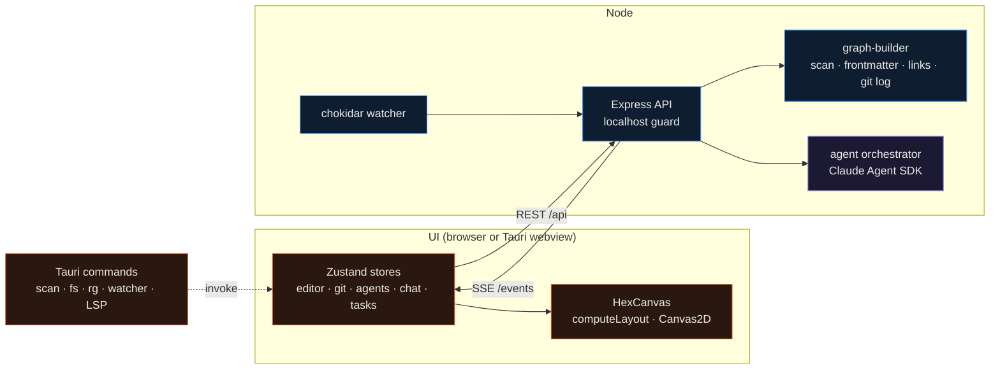
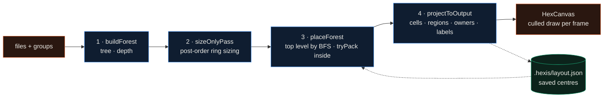

# Hexis architecture

These notes follow the code at version 0.1.0. Paths are relative to the repo root.

## Processes

Hexis is three programs that share one React front end.

- The UI (`src/`) is React 18 with Zustand stores, a Canvas2D renderer for the grid and CodeMirror 6 for the editor. Vite serves it on port 5173 and proxies `/api` and `/events` to `127.0.0.1:3001`.
- The API server (`server/index.js`) is Express 4 on Node. It owns the project path, the git repository, the terminal, the test runner, project memory and every Claude Agent SDK call.
- The Tauri shell (`src-tauri/`) is optional. It replaces some API calls with Rust commands: project scan (stored in SQLite), file reads and writes, create, rename, move and delete (to the OS trash), ripgrep search, a `notify` file watcher and a stdio bridge to language servers.

`mcp-server.js` is a fourth, separate process: a stdio MCP server for Claude Code that reuses the graph builder and the git wrappers.

### Transport

Everything the UI asks for is a REST call. Everything the server volunteers arrives on one SSE stream
(`GET /events`). On connect the stream sends `connected` (with the project path, used to scope chat history) and a
`state_snapshot`. After that it carries:

- `fileChange` batches from the watcher,
- `branchChange` after a checkout,
- agent events: `agent_spawned`, `agent_stream` (text deltas), `agent_reading`, `agent_editing`, `agent_complete`, `agent_error`, `plan_ready`, `subtask_complete`, `task_review`, `task_complete`, `tokens_update`,
- chat events: `chat_turn_started`, `chat_tool_result`, `chat_turn_complete`, `chat_turn_failed`,
- research events: `research_started`, `research_plan_ready`, `research_gather_complete`, `research_ranking_complete`, `research_critique_complete`, `research_report_ready`, `research_tasks_ready`, `research_complete`.

The first middleware checks every request: the Host header must be `localhost`, `127.0.0.1` or `[::1]`, an
Origin header must be in `HEXIS_ALLOWED_ORIGINS`, and `Sec-Fetch-Site: cross-site` is refused. File endpoints then
check that the path stays inside the project with `path.relative`, so a sibling such as `../Hexis-other` fails too.

## From disk to cells

### Scanning

`GET /api/graph` calls `buildGraph()` in `server/graph-builder.js`:

1. `parsers/directory.js` walks the project. It skips dot-folders and a fixed list of folders (`.git`, `.claude`,
   `node_modules`, `nebula`, `.github`, `scripts`, `dist`, `build`, `target`, `out`, `.next`, `.nuxt`, `.cache`,
   `coverage`, `.vscode`, `.idea`), hides dotfiles except a short allow-list (`.env`, `.gitignore`, `.editorconfig`
   and similar), and drops binary extensions (images, archives, fonts, media, office documents, compiled objects).
2. For each file it reads frontmatter with gray-matter, extracts relative markdown links outside code fences, and
   runs `git log --max-count=100` on that file for last-modified date, change count, contributors and age. These
   calls run one after another, which is why opening a large project is slow.
3. It builds edges from markdown links, frontmatter `related` and `applied_to` lists, and pairs of files in different
   sections that share two or more tags.
4. `README.md` files are pulled out into a `readmeMap` of folder metadata, and every directory becomes a cluster.

The response also carries local branches and the last 200 commits across all refs. `App.jsx` maps nodes to files
(`path`, `group_path`, `is_landmark` for `index`, `main`, `App`, `README` and `mod`, `is_test`, `is_config`) and
clusters to groups (`path`, `parent_path`, `depth`). Edges and the README metadata are not used by the grid today.

Under Tauri, `scan_project` in `src-tauri/src/lib.rs` does its own walk with a shorter ignore list (`.git`,
`node_modules`, `.claude`, `dist`, `target`, `__pycache__`, `.next` and dot-entries other than `.env`), writes files
and groups to SQLite (`<data dir>/hexis/hexis.db`, WAL mode), and `get_files` / `get_groups` read them back. It keeps
binaries, README files and `scripts/`, so the same project shows more cells in the desktop window: 95 against 74 for
the forge-llm checkout in the README screenshots.

### Hex coordinates

`src/components/utils/hexMath.js` uses flat-top hexagons in odd-q offset coordinates: `q` is the column, `r` the
row, and odd columns sit half a hex lower. `hexToPixel` spaces cells at 1.5 × size horizontally and √3 × size
vertically, with a 6% gap. Distances go through cube coordinates. A filled hex of ring `r` has `3r² + 3r + 1` cells,
and `cellsAtDistance` and `getHexDisk` enumerate rings and disks by scanning a bounding box, which stays correct
under the odd-q parity shift. Cells are 30 px in world units.

### Layout pipeline

`computeLayout(files, groups, hexSize, savedState)` in `src/components/utils/hexLayout.js` runs four stages. Every
folder is a perfect hexagon, child folders sit fully inside their parent, nesting depth is unbounded, and each
folder keeps at least one empty cell as a drop target.

1. `buildForest` turns the flat group list into a tree under a virtual root and attaches each file to its folder.
2. `sizeOnlyPass` sizes rings bottom-up. A folder starts at one ring more than its largest child, grows until its
   disk can hold its direct files, its children's disks and one free cell, and then grows further until `tryPack`
   succeeds at a virtual centre. Ring 24 (1,801 cells) is the hard limit; past it the layout throws.
3. `placeForest` places top-level folders on the open plane, largest first, at the first cell found by a BFS from the
   origin (up to distance 80) that keeps a gap from every folder already placed. Inside each folder `placeSubtree`
   runs `tryPack` again at the real centre, because odd-q parity can make a packing that worked at the origin fail
   elsewhere, and grows the ring if needed.
4. `projectToOutput` emits the disk of every folder, puts direct files on the free cells nearest the folder centre
   (landmarks first), lays root-level files out by BFS from the first free cell near the origin, builds a
   `cellOwner` map (files win, empty cells belong to the deepest folder that covers them) and resolves label
   collisions by moving plates up, then below the folder.

`tryPack(box, cq, cr, R)` is the core test. Children are sorted by ring. The largest child tries the saved position
first, then every cell within distance 4 of the centre, then one rim ring. For each of those, the remaining children
take the first free spot scanning from the rim inward. Two folders don't overlap when
`hexDistance(a, b) ≥ ring_a + ring_b + 1`, an O(1) check. A candidate is accepted only if the free cells left over
can hold the folder's direct files plus one.

The returned `_savedState` holds each folder's centre and ring. The UI stores it in localStorage and in
`.hexis/layout.json` (through `PUT /api/layout-state`, or `write_file` under Tauri) and passes it back as hints on the
next run, so folders keep their places when files are added. Ctrl+Shift+L clears it and repacks from scratch.
`hexMath.test.js` (33 tests) and `hexLayout.test.js` (17 tests) cover the coordinate math and the packing invariants.

### Rendering

`HexCanvas.jsx` owns a `Viewport` with zoom between 0.05 and 5. Wheel input adds zoom velocity that decays by 0.85
per frame around the cursor; programmatic moves animate for 220 to 620 ms depending on distance. The semantic level
is picked from the zoom: satellite below 0.12, region below 0.25, city below 0.55, street below 1.5, interior above.
At satellite a file is a dot, at region a tinted hex, and from city on it gets its initial, name, git badge and agent
glow. Only cells inside `getVisibleHexRange` are drawn. `LayoutAnimator` tweens cells to their new positions after a
re-layout, `CellDrag` computes drop targets while a file or folder is dragged, and `BeeSystem` draws one bee per
running agent and steers it toward the file in that agent's latest `agent_reading` or `agent_editing` event, where it
hovers until the next one.
Git status is merged into the file objects in place, so a status change repaints cells without running the layout
again.

## Persistence

| What | Where | Written by |
|---|---|---|
| Folder centres and rings | `<project>/.hexis/layout.json` and localStorage | `layoutStateStore` through `/api/layout-state` or `write_file` |
| Project conventions | `<project>/.hexis/memories/learned.md` | chat "star to memory", Memory panel, `/api/memory/seed`, agents' `memory_append` tool |
| Rule usage stats | `<project>/.hexis/memories/meta.json` | `/api/memory/search`; used to rank rules, decaying over 30 days |
| Research reports | `<project>/.hexis/memories/research/<slug>.md` | research pipeline |
| Agent runs | `~/.hexis/state-<hash>.json` | `state-store.js`, debounced 250 ms; last 500 events per run, last 100 finished runs |
| Repo summary | `~/.hexis/wiki-<hash>.json` | `repo-context.js`, keyed by HEAD sha |
| Worktrees | `~/.hexis/worktrees/<run>` | `worktree-manager.js`, only when a run asks for isolation |
| Panels, prefs, tasks, chats, bookmarks, local history | browser localStorage, `hexis-*` keys | the Zustand stores |
| Desktop scan cache | `<data dir>/hexis/hexis.db` | Tauri `scan_project` |

`<hash>` is the first 12 hex digits of the SHA-1 of the project path. When the server starts, runs that were still
planning, executing or reviewing are marked `interrupted`. The panel layout in localStorage is versioned, migrated
on load and healed if docked panels would cover more than 85% of the window.

## Git layer

`server/git-analyzer.js` wraps one simple-git instance bound to the project. Reads: status (with dotfiles and
`node_modules` filtered out), local branches, the commit log across all refs, per-file logs, diff summaries and file
diffs, `blame --porcelain` and `show`. Writes: add, `reset HEAD -- files` for unstaging, commit and amend, push and
pull against `origin` and the current branch, create, checkout, merge and delete branches, stash push, pop and drop,
`revert --no-edit`, `reset` in soft, mixed or hard mode, and fetch. Failures come back as `{ error }` instead of HTTP
errors.

Moving a file goes through `POST /api/file/move`: it checks that the source exists and the destination doesn't, runs
`git mv` (falling back to a plain rename for untracked files), then `link-updater.js` scans every markdown file,
rewrites relative links (and their `#anchor`) that pointed at the old path, and stages each file it changed. Folder
moves are a plain rename. The UI refreshes git status every 10 seconds and after file events.

## File watching

`server/watcher.js` watches the project root with chokidar 4. Chokidar 4 no longer accepts glob patterns, so filtering happens
in an `ignored(path, stats)` callback: any path segment in a fixed list (`node_modules`, `.git`, `.claude`, `dist`,
`build`, `target`, `out`, `.next`, `coverage`, `nebula`, `.github`, `.hexis`, `.serena`, `.vite`, `.turbo`, `.cache`,
`__pycache__`) is ignored, directories are always walked, and files must have one of 41 source, config or doc
extensions. Writes settle for 300 ms (`awaitWriteFinish`), events collect for 500 ms, and the batch goes out as one
`fileChange` SSE event. The UI debounces for 200 ms and then fetches the whole graph again; its own create, move and
delete operations patch the grid optimistically first.

Under Tauri, `src-tauri/src/fs_watcher.rs` does the same job with `notify` and a 250 ms debouncer and emits
`hexis://fs_change` events. The UI subscribes with Tauri's event API, which needs a capability grant this repo
doesn't ship yet.

## Agents

### One call

`runAgent()` in `server/agent-orchestrator.js` builds the options for each `query()`:

- `model`, `effort`, `maxTurns` and, for Opus roles, `thinking: { type: 'adaptive' }` with `fallbackModel: 'sonnet'`, from `agent-profiles.js`;
- `allowedTools` for the role and a `permissionMode` (`plan` for read-only roles, `bypassPermissions` for writers);
- an environment copy without `ANTHROPIC_API_KEY`, so the bundled Claude Code CLI uses the machine's Claude Code login;
- `settingSources` of `project` for lightweight roles and `user`, `project`, `local` for the rest, so project `CLAUDE.md` and `.claude/` settings apply;
- an in-process MCP server (`hexis-mcp-tools.js`) and, unless the role is lightweight or `HEXIS_DISABLE_SERENA=1`, Serena over stdio through `uvx`;
- hooks from `agent-hooks.js` (not for lightweight roles): PreToolUse refuses Write, Edit, MultiEdit and NotebookEdit on lockfiles, `.env*`, `tauri.conf.json`, `node_modules` and `.git`; PostToolUse records each edit and broadcasts it; SessionStart injects `git log -5` for up to ten focus files;
- the `claude_code` system prompt preset with an appended preamble (shared consistency rules, `AGENTS.md` or `CLAUDE.md` capped at 8 KB, the cached repo summary and `learned.md` capped at 4 KB) and dynamic sections excluded, so parallel runs share a prompt-cache prefix;
- `outputFormat: { type: 'json_schema' }` when the role returns structured data.

The stream is read message by message: text deltas go out as `agent_stream`, Read and Write/Edit tool calls as
`agent_reading` and `agent_editing`, token usage is summed, and tool results are paired with their calls for the chat
panel. An agent that makes the same call five times in a row is stopped. Rate-limit, network and timeout errors are
retried up to three times, waiting 1.5 s × 2ⁿ plus jitter.

| Role | Model | Effort | Max turns | Tools | Permission mode |
|---|---|---|---|---|---|
| writer | haiku | low | 2 | none | plan |
| classifier | haiku | low | 3 | none | plan |
| analyst | sonnet | medium | 15 | read | plan |
| planner | opus | high | 40 | read | plan |
| coder | sonnet | high | 80 | full | bypassPermissions |
| persona reviewer | sonnet | medium | 20 | review | plan |
| merging reviewer | opus | high | 25 | review | bypassPermissions |
| chat | sonnet or opus | high | 40 | full | bypassPermissions |
| research lead | opus | high | 22 | research | plan |
| research worker | sonnet | medium | 12 | research | plan |
| research critic | sonnet | high | 10 | research | plan |

"Read" is Read, Glob, Grep, Bash, TodoWrite, Task plus the repo-stats, git and memory-read MCP tools. "Full" adds
Write, Edit, NotebookEdit, the test and lint tools and memory writes. "Review" is Read, Glob, Grep, Bash, the two
git tools and memory view, search and append. "Research" is WebFetch, Read, Glob, Grep and the web, arXiv, GitHub, Hacker News, npm, memory and
report-saving tools.

### Task pipeline

`POST /api/agent/start` calls `startTask()`:

1. The classifier labels the prompt `readonly`, `edit` or `trivial_edit` (falling back to `edit` on any error).
2. `readonly` goes to the analyst, which answers in prose and ends the run.
3. Otherwise the planner explores and returns `{ summary, subtasks: [{ id, title, description, files, action, dependsOn }] }`.
4. `scheduleSubtasks()` packs subtasks into waves. A subtask is ready when everything in its `dependsOn` has finished
   (unknown ids count as finished, and a cycle releases everything left), and a wave never holds two subtasks that
   list the same file. Waves run one after another and the subtasks in a wave run in parallel. The first coder of
   the first wave resumes the planner's session to reuse its cached reads.
5. After a coder reads or edits a `.js`, `.ts`, `.py`, `.rs`, `.go` or `.java` file, the orchestrator runs
   `npm test -- --run` and, while the output reports failures, resumes the coder with the last 2,500 characters of it,
   up to three times.
6. With no edits the run ends approved. `trivial_edit` runs end with an automatic approval.
7. Otherwise the three persona reviewers read `getGitDiff()` in parallel and return `{ approved, confidence, summary, issues }`,
   and the merging reviewer combines them into a final verdict plus `learnedConventions`.
8. If the verdict isn't approved and lists critical issues, the last coder session is resumed once with those issues,
   and the run is then marked approved.

Each event is tagged with the run id, journaled to the state store and broadcast. The UI's `agentStore` keeps one
record per run, and `taskStore` moves the linked card to Done when the review approved it and to Needs Review
otherwise. The board picks queued tasks itself: up to three runs at once, highest priority first, skipping tasks whose
files overlap a running task's files or whose dependencies aren't done.

`startTask()` can also put a run in a detached git worktree under `~/.hexis/worktrees`, apply its diff back with
`git apply --3way` on success and remove the worktree afterwards. The API doesn't pass that option today, so runs work
in the project directory.

### Chat, task writer, inline edit and research

A chat message is one `runAgent()` call with the chat profile and the coder's tools, resuming the SDK session id the
UI sent with it. Slash commands in the chat panel route to the task pipeline (`/task`), the research pipeline
(`/research`), memory search and consolidation (`/mem`), and a Haiku summary of older turns (`/compact`).

`POST /api/task/write` turns a rough prompt into `{ title, description, files, priority, scope }`. When the prompt
already names a file and starts with an action verb it skips the model and fills the fields locally.

`POST /api/ai/edit` (Ctrl+K in the editor) sends the selection (or the current line) with 1,500 characters of context
on each side to `claude-sonnet-4-5`, one turn, no tools, and returns only the replacement text.

The research pipeline has five timed phases: plan (Opus, 5 minutes), gather with two to five parallel Sonnet workers
(8 minutes), rank against a rubric (Opus, 4 minutes), adversarial critique (Sonnet, 4 minutes) and synthesis (Opus,
6 minutes). The orchestrator saves the final markdown to `.hexis/memories/research/<slug>.md` and can turn the
report's next steps into board tasks. Workers search DuckDuckGo's HTML endpoint, read pages through Jina Reader
(`r.jina.ai`) and query arXiv, the GitHub search API (60 requests per hour, more with `GITHUB_TOKEN`), Hacker News
through Algolia, and the npm registry.

### Start-up calls

When the server starts it fires a one-turn "ping" with the chat profile so the first real chat turn doesn't pay the
SDK's cold start (it gives up waiting after 8 seconds). `initRepoContext()` loads `AGENTS.md` or `CLAUDE.md` and
`learned.md`, and if `~/.hexis/wiki-<hash>.json` doesn't match the current HEAD it runs a Sonnet agent with Read,
Glob and Grep (up to 25 turns) in the background to write a repo summary for the preamble.

## Standalone MCP server

`mcp-server.js` takes the project path as its first argument (or `HEXIS_TARGET`), rebuilds the graph at most every
5 seconds, and serves nine tools over stdio: a graph summary with counts by section, type and status,
`hexis_search_nodes`, `hexis_get_node`, `hexis_get_group`, `hexis_get_connections`, `hexis_health_check` (missing
frontmatter, broken links, orphans), `hexis_git_status`, `hexis_find_orphans` and `hexis_find_stale`. Several of them
assume markdown files with
frontmatter, which is where the project started, so on a code repository they mostly report what is missing.
